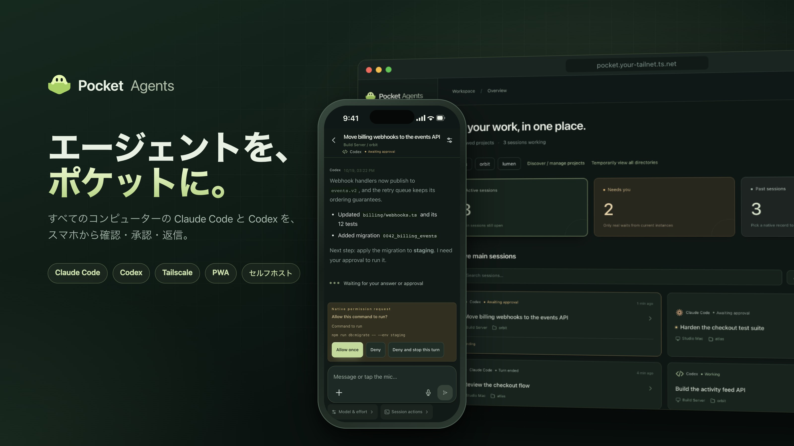
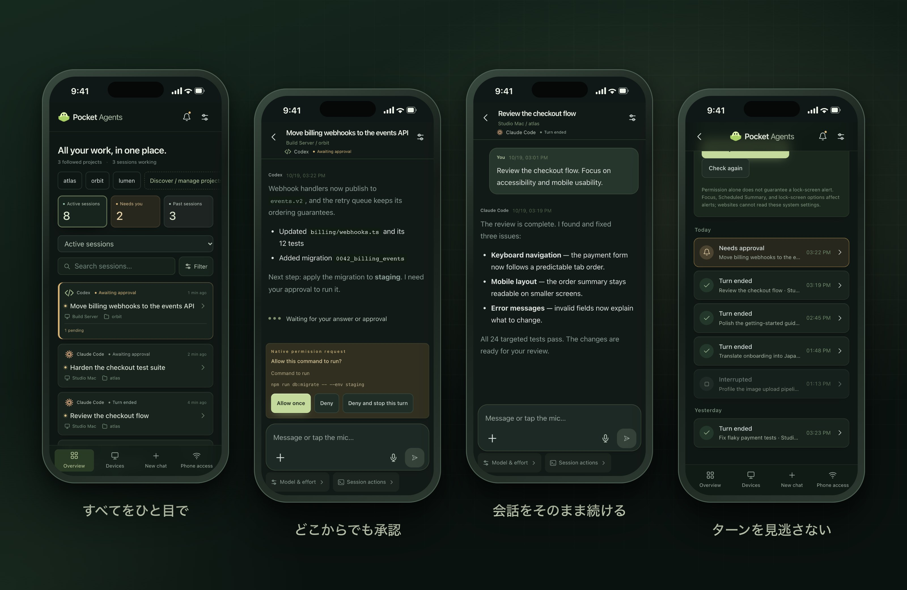
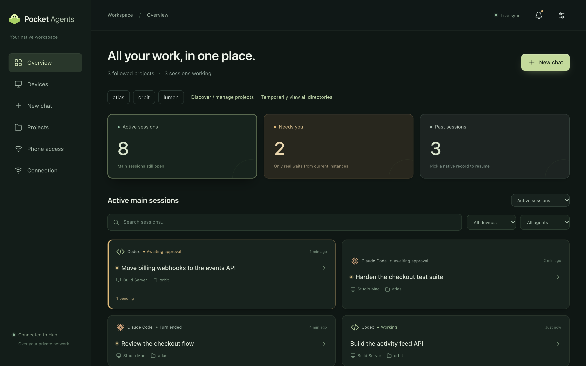
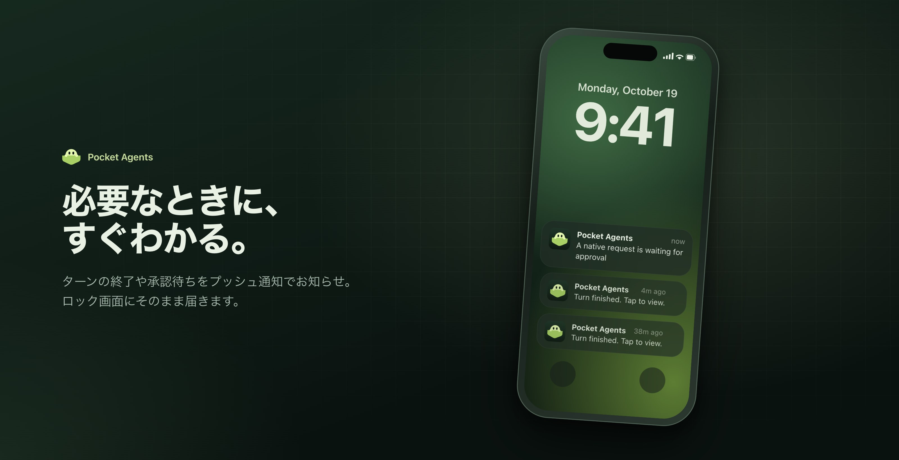
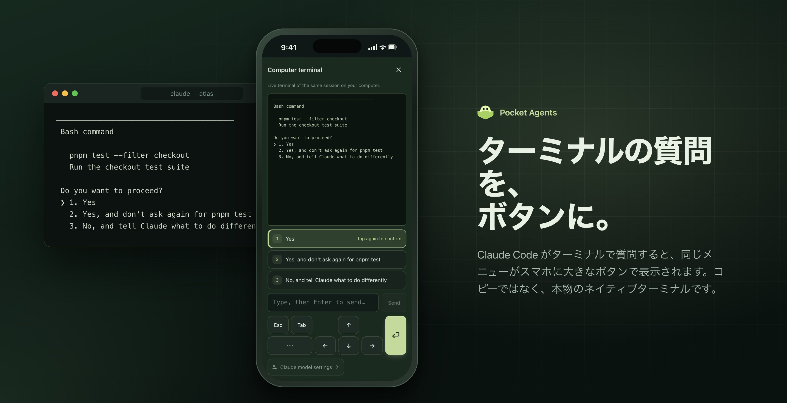
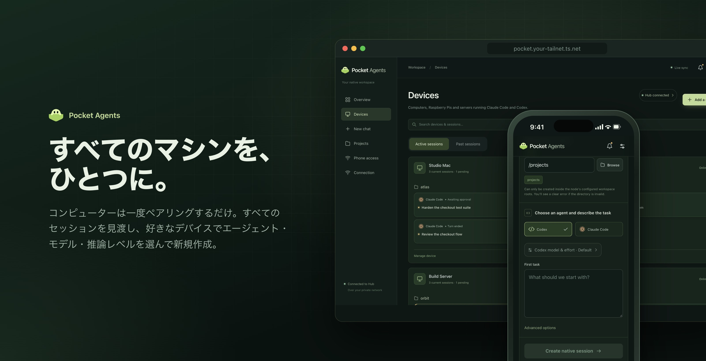
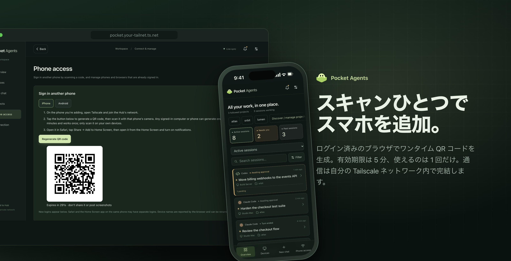
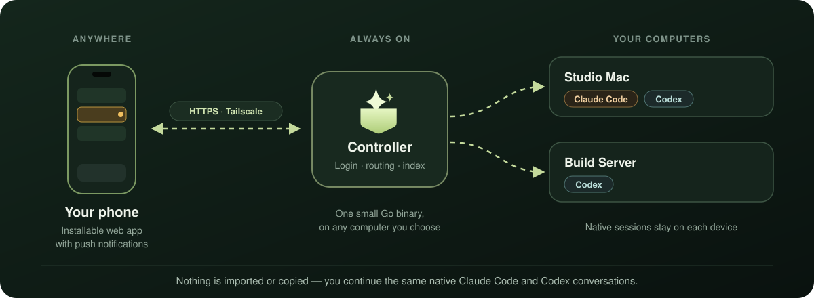

<p align="center">
  
</p>

<h1 align="center">
  &nbsp;Pocket Agents
</h1>

<p align="center">
  <b>エージェントが作業中でも、デスクにいる必要はありません。</b><br>
  すべてのコンピューターの Claude Code と Codex を操作する、セルフホスト型・モバイルファーストのコンソール。
</p>

<p align="center">
  <a href="LICENSE"></a>
  
  
  
</p>

<p align="center">
  <a href="README.md">English</a> · <a href="README.zh-CN.md">简体中文</a> · <b>日本語</b>
</p>

スマートフォンから進捗を確認し、質問に答え、コマンドを承認して、**同じネイティブ会話**をそのまま続けられます。

## 画面プレビュー

<p align="center">
  
</p>

<details>
<summary><b>大きな画面では</b></summary>
<br>

</details>

<sub>実際の UI に架空のデモデータを表示しています。個人の会話やデバイスのアドレスは含みません。現在の UI は英語と中国語に対応しています。</sub>

## ハイライト

<p align="center">
  
</p>

<p align="center">
  
</p>

<p align="center">
  
</p>

<p align="center">
  
</p>

## 仕組み

<p align="center">
  
</p>

## 主な機能

- 👀 プロジェクトや実行デバイスごとにセッションを表示。
- 💬 ネイティブ会話を継続し、各エージェントが対応する承認・ターミナル操作を利用。
- 📎 画像やファイルを送り、セッションのプロジェクトから成果物を取得。
- 🔔 ターンの終了や対応が必要なときに通知。
- 🔒 自分の Tailscale ネットワークと、独立したアプリ認証で接続。

会話履歴はネイティブツールが管理します。Pocket Agents はエージェントのランタイムを置き換えず、会話ファイルのインポートも不要です。

## 開発状況と必要なもの

**現在、開発を進めています。** ネイティブ連携は CLI のバージョンに依存します。macOS は実機で検証していますが、Linux のビルドや自動テストの成功は、Linux 上のすべての動作を保証しません。モバイルでの動作はブラウザーやインストール方法によって異なります。[互換性](docs/COMPATIBILITY.md)と[検証方針](docs/ACCEPTANCE.md)をご確認ください。

Tailscale、インストールとログインを済ませた Claude Code または Codex CLI、およびスマートフォンから到達できるコンピューターが必要です。ソースからのビルドには Go 1.24+、Node.js 22.12+、npm が必要です。Windows は現在未対応です。

## ビルドと起動

```sh
git clone https://github.com/kwok-linton/pocket-agents.git
cd pocket-agents
make build
./bin/pocket doctor
./bin/pocket setup
```

`setup` はユーザーサービスをインストールし、ローカルの設定画面を開きます。画面の案内に従ってプライベート HTTPS を設定し、スマートフォンを接続してください。CLI の認証や作業ディレクトリの信頼確認は、ネイティブツールで先に行ってください。

開発用にフォアグラウンドで起動する場合は `./bin/pocket both` を使います。既定のローカルアドレスは `http://127.0.0.1:8787` です。開発用とインストール済みのサービスで、同じポートやデータディレクトリを共有しないでください。

## スマートフォンを接続

1. コントローラーとスマートフォンを、相互接続が許可された同じ Tailscale ネットワークに接続します。
2. 設定画面の案内に従って Tailscale Serve の HTTPS を設定します。
3. ログイン済みのブラウザーで「Phone access」を開き、ログイン用 QR コードを生成します。コンピューターでも、別のスマートフォンでも生成できます。
4. 接続するスマートフォンでスキャンします。QR コードは5分間有効で、1回だけ使用できます。

iPhone では Safari からホーム画面に追加し、ホーム画面から開いて通知を有効にしてください。Android Chrome では PWA をインストールできます。通知には、コントローラーからプッシュサービスへの通信も必要です。

別の実行デバイスを追加するには、デバイス設定画面でワンタイムのペアリングコマンドを生成し、対象のコンピューターで実行します。明示的にペアリングしたデバイスだけにアクセスします。

## 開発とドキュメント

開発前に [AGENTS.md](AGENTS.md) と[アーキテクチャ](docs/ARCHITECTURE.md)を参照してください。

```sh
npm --prefix web ci
make check
```

通常のテストは隔離された fixture を使います。実際のエージェントを使う検証は明示的に実行し、セッションの作成やモデル利用量の消費を伴う場合があります。作業中のセッションをテストに使わないでください。

- [インストールと運用](docs/INSTALL.md)
- [セットアップとブラウザー管理](docs/ONBOARDING.md)
- [互換性と制限](docs/COMPATIBILITY.md)
- [検証チェックリスト](docs/ACCEPTANCE.md)

## ライセンス

Pocket Agents は**ソース公開型ソフトウェアであり、OSI が定義するオープンソースではありません**。オリジナルコードには [PolyForm Noncommercial 1.0.0](LICENSE) が適用されます。

- 個人利用、学習、研究、趣味のプロジェクト、非営利団体での利用は**無料**です。
- **業務その他の商用目的での利用には商用ライセンスが必要です。** [商用ライセンスの申請](https://github.com/kwok-linton/pocket-agents/issues/new?title=Commercial%20license)を作成するか、[@kwok-linton](https://github.com/kwok-linton) にご連絡ください。

許可範囲と例外はライセンス全文をご確認ください。過去のライセンスに基づく既存の許諾は遡って取り消されません。依存関係の表記は [THIRD_PARTY.md](THIRD_PARTY.md) を参照してください。

## 作者

[Ronnie Lintao Guo](https://github.com/kwok-linton) が、デスクを離れても AI コーディングツールを使い続けたいという日常のニーズから開発しています。
