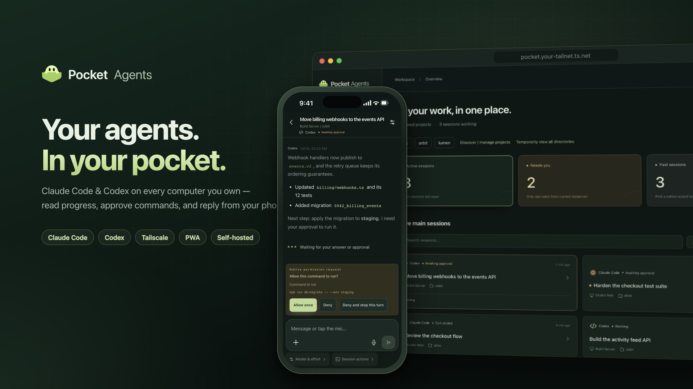
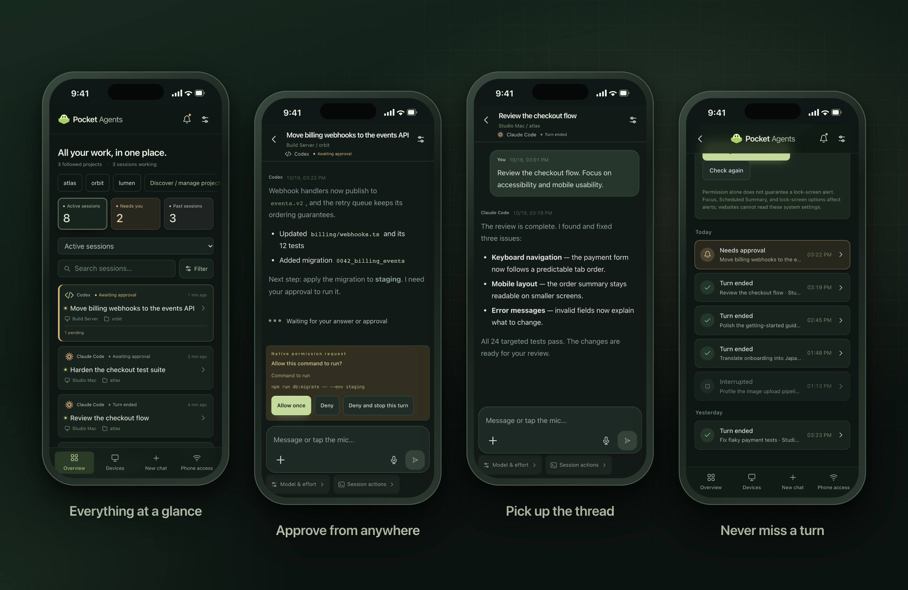
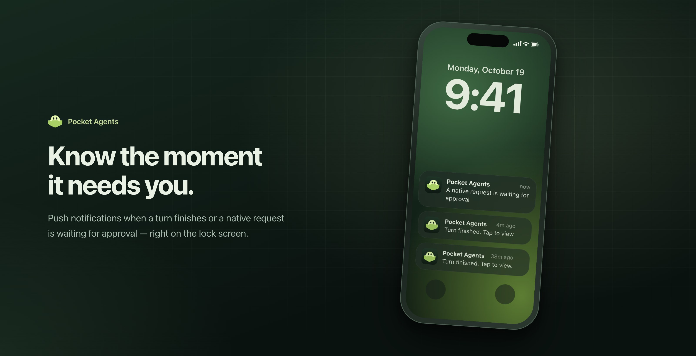
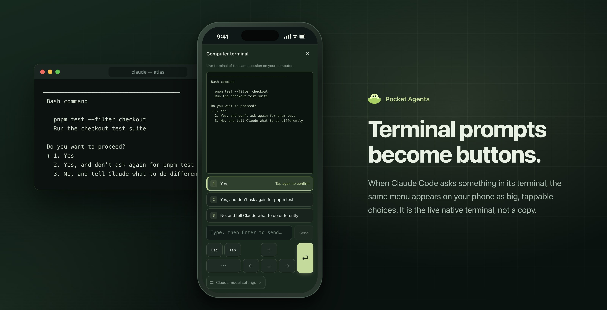
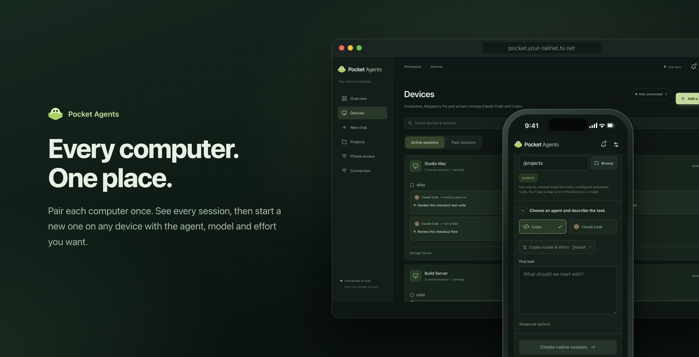
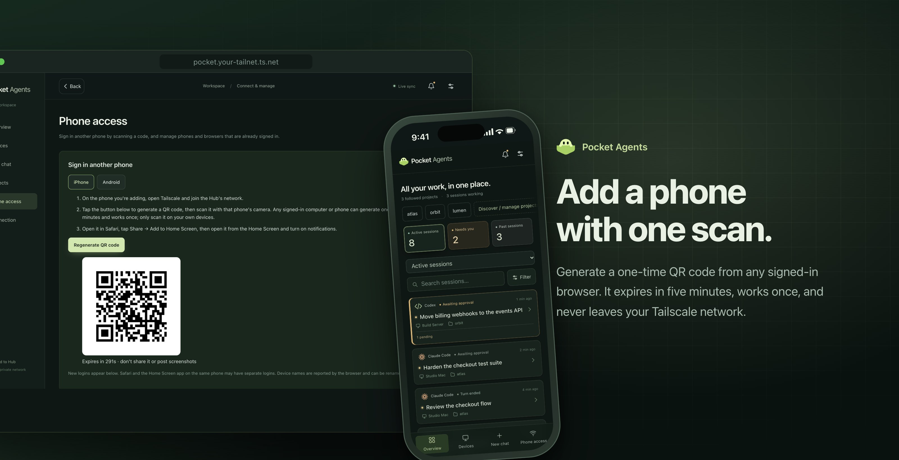

<p align="center">
  
</p>

<h1 align="center">
  &nbsp;Pocket Agents
</h1>

<p align="center">
  <b>Your agents are working. You don't have to stay at your desk.</b><br>
  A self-hosted, mobile-first console for the Claude Code and Codex sessions on all your computers.
</p>

<p align="center">
  <a href="LICENSE"></a>
  
  
  
</p>

<p align="center">
  <b>English</b> · <a href="README.zh-CN.md">简体中文</a> · <a href="README.ja.md">日本語</a>
</p>

Read progress, answer questions, approve commands, and continue the **same native conversation** from your phone — then pick it up again at your desk as if you never left.

## A look inside

<p align="center">
  
</p>

<details>
<summary><b>On a larger screen</b></summary>
<br>

</details>

<sub>Actual interface rendered with fictional demo data — no private sessions or device addresses are shown.</sub>

## Highlights

<p align="center">
  
</p>

<p align="center">
  
</p>

<p align="center">
  
</p>

<p align="center">
  
</p>

## How it works

<p align="center">
  
</p>

## What you can do

- 👀 Browse sessions by project and execution device.
- 💬 Continue native conversations, with provider-specific approval and terminal controls.
- 📎 Send images and files, and retrieve results from the session's project.
- 🔔 Receive notifications when a turn finishes or needs your attention.
- 🔒 Connect through your own Tailscale network, with separate application authentication.

Native tools remain the source of truth for conversation history. Pocket Agents does not replace the agent runtime or require you to import your chat files.

## Status and requirements

**Under active development.** Native integrations depend on CLI versions. macOS has been exercised on real devices; Linux builds and automated checks do not establish complete Linux runtime support. Mobile behavior varies by browser and installation mode. See [compatibility](docs/COMPATIBILITY.md) and [validation](docs/ACCEPTANCE.md).

You need Tailscale, an installed and authenticated Claude Code and/or Codex CLI, and a computer that remains reachable while you use your phone. Source builds require Go 1.24+, Node.js 22.12+, and npm. Windows is not currently supported.

## Build and start

```sh
git clone https://github.com/kwok-linton/pocket-agents.git
cd pocket-agents
make build
./bin/pocket doctor
./bin/pocket setup
```

`setup` installs a user service and opens the local setup interface. Follow it to configure private HTTPS and connect your phone. If the CLI needs authentication or workspace trust, complete that in the native tool first.

For a foreground development server instead of an installed service:

```sh
./bin/pocket both
```

The local default is `http://127.0.0.1:8787`. Do not run development and installed services against the same port or data directory.

## Connect your phone

1. Connect the controller and phone to the same permitted Tailscale network.
2. Configure Tailscale Serve HTTPS using the setup interface's instructions.
3. Open **Phone access** in an already authenticated browser and generate a login QR code. This browser can be on a computer or another phone.
4. Scan it with the phone you want to connect. The QR code expires after five minutes and can be used once.

On iPhone, add the site to your Home Screen from Safari, open it there, and enable notifications. Android Chrome supports installing the PWA. Push delivery also requires outbound access from the controller to the push service.

To add another execution computer, use the device setup flow and run its one-time pairing command on that computer. Only explicitly paired devices are accessed.

## Development

Read [AGENTS.md](AGENTS.md) for development rules and [architecture](docs/ARCHITECTURE.md) for the code layout.

```sh
npm --prefix web ci
make check
```

Tests use isolated fixtures by default. Real-provider probes are opt-in and may create native sessions or consume model usage. Never point tests at someone else's working session.

## Documentation

- [Installation and operation](docs/INSTALL.md)
- [Setup and browser access](docs/ONBOARDING.md)
- [Compatibility and limitations](docs/COMPATIBILITY.md)
- [Validation checklist](docs/ACCEPTANCE.md)

## License

Pocket Agents is **source-available, not OSI-approved open source**. Original code is licensed under [PolyForm Noncommercial 1.0.0](LICENSE).

- **Free** for personal use, learning, research, hobby projects and noncommercial organizations.
- **Using it for work or any other commercial purpose requires a commercial license.** To get one, [open a commercial license request](https://github.com/kwok-linton/pocket-agents/issues/new?title=Commercial%20license) or contact [@kwok-linton](https://github.com/kwok-linton).

The full license defines the exact permissions and exceptions. Existing grants under earlier licenses are not retroactively revoked. Dependency notices are in [THIRD_PARTY.md](THIRD_PARTY.md).

## Author

Created by [Ronnie Lintao Guo](https://github.com/kwok-linton), from a daily need to keep working with coding agents away from the desk.
