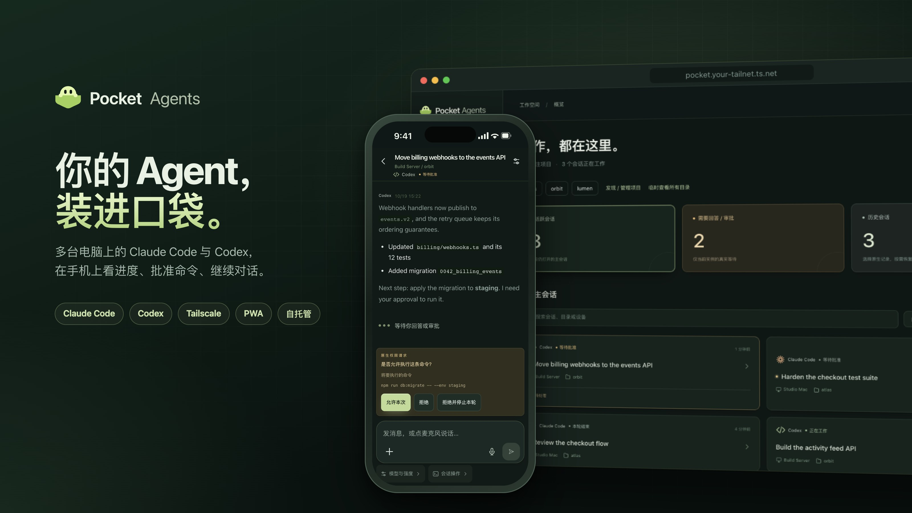
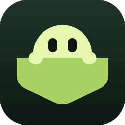
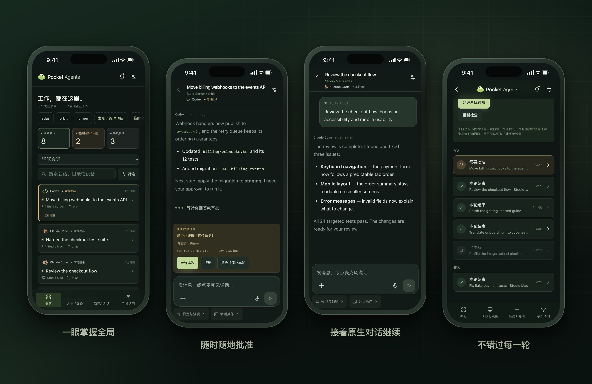
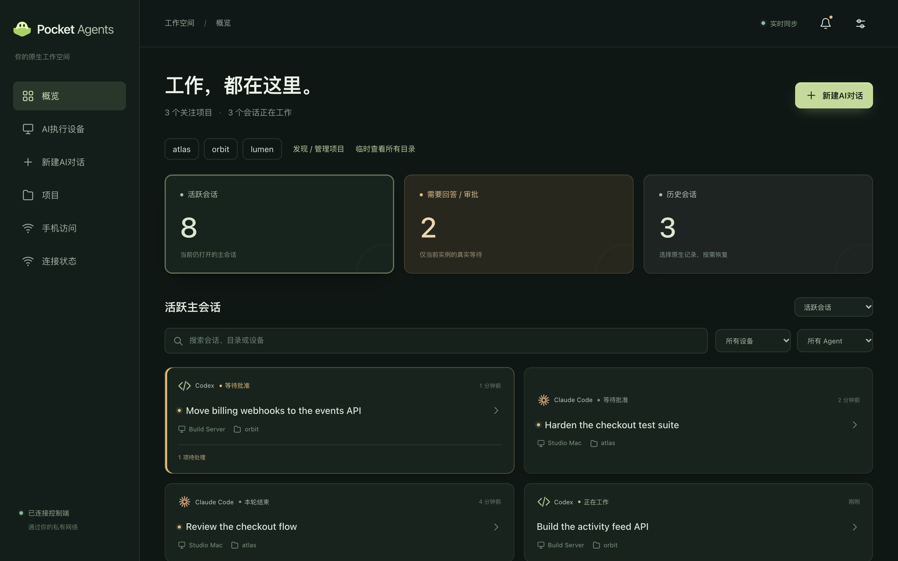
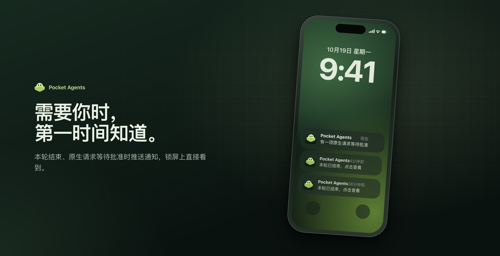
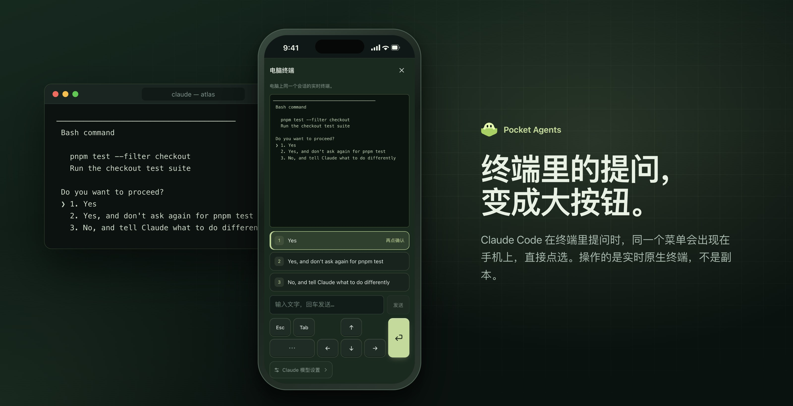
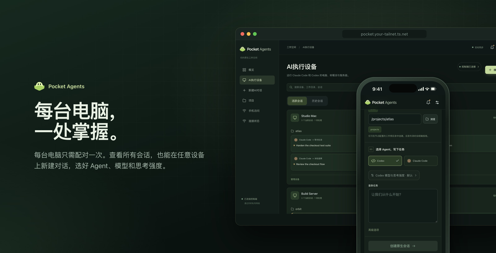
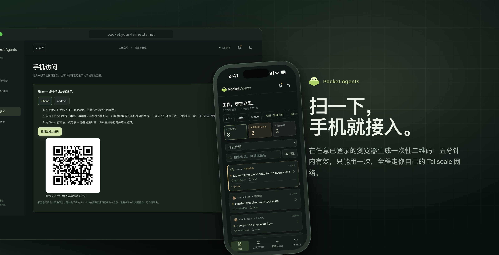
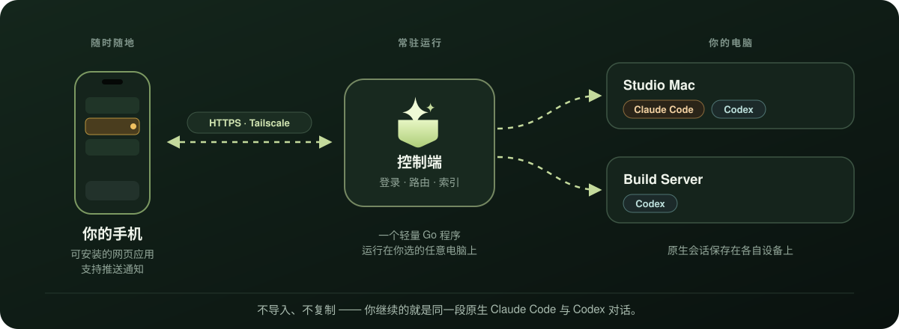

<p align="center">
  
</p>

<h1 align="center">
  &nbsp;Pocket Agents
</h1>

<p align="center">
  <b>Agent 继续工作，你不必一直守在电脑前。</b><br>
  自托管、手机优先的 Claude Code 与 Codex 会话控制台，连接你所有的电脑。
</p>

<p align="center">
  <a href="LICENSE"></a>
  
  
  
</p>

<p align="center">
  <a href="README.md">English</a> · <b>简体中文</b> · <a href="README.ja.md">日本語</a>
</p>

在手机上查看进度、回答问题、批准命令，继续的是**同一段原生对话**——回到电脑前也能无缝接上。

## 界面预览

<p align="center">
  
</p>

<details>
<summary><b>大屏幕上的样子</b></summary>
<br>

</details>

<sub>真实前端界面，使用虚构演示数据；不包含私人会话或设备地址。</sub>

## 亮点

<p align="center">
  
</p>

<p align="center">
  
</p>

<p align="center">
  
</p>

<p align="center">
  
</p>

## 工作方式

<p align="center">
  
</p>

## 可以做什么

- 👀 按项目和 AI 执行设备查看会话。
- 💬 继续原生对话，使用对应 Agent 支持的审批与终端操作。
- 📎 发送图片和文件，取回会话项目中的结果文件。
- 🔔 接收本轮结束或需要你处理的通知。
- 🔒 通过自己的 Tailscale 私网连接，并使用独立的应用认证。

对话历史仍由原生工具保存。Pocket Agents 不替代 Agent runtime，也不要求导入聊天文件。

## 状态与前提

**项目仍在积极开发。** 原生集成依赖 CLI 版本。macOS 已进行真实设备验证；Linux 编译和自动测试通过不代表完整的 Linux 运行体验已验收。手机行为依赖浏览器和安装方式。请阅读[兼容性](docs/COMPATIBILITY.md)和[验收说明](docs/ACCEPTANCE.md)。

需要 Tailscale、已安装并登录的 Claude Code 和／或 Codex CLI，以及手机使用时仍可连接的电脑。源码构建需要 Go 1.24+、Node.js 22.12+ 和 npm。目前不支持 Windows。

## 构建与启动

```sh
git clone https://github.com/kwok-linton/pocket-agents.git
cd pocket-agents
make build
./bin/pocket doctor
./bin/pocket setup
```

`setup` 安装用户级后台服务并打开本地设置页面。按页面引导配置私网 HTTPS，再接入手机。CLI 登录或工作目录信任须先在原生工具中完成。

如需前台开发服务，可运行 `./bin/pocket both`。默认本地地址为 `http://127.0.0.1:8787`；开发服务不要与已安装服务共用端口或数据目录。

## 连接手机

1. 控制端和手机连接同一个允许互访的 Tailscale 网络。
2. 按设置页面说明配置 Tailscale Serve HTTPS。
3. 在任意已登录的浏览器中打开「手机访问」并生成登录二维码。电脑或另一部手机都可以生成。
4. 用待连接手机扫码。二维码五分钟内有效，只能使用一次。

iPhone 请通过 Safari 添加到主屏幕，从主屏幕打开后启用通知。Android Chrome 支持安装 PWA。控制端需要能访问推送服务。

接入另一台 AI 执行设备时，通过设备接入流程生成一次性配对命令，并在目标电脑执行。应用只访问明确配对的设备。

## 开发与文档

先阅读 [AGENTS.md](AGENTS.md) 和[架构说明](docs/ARCHITECTURE.md)。

```sh
npm --prefix web ci
make check
```

普通测试默认使用隔离 fixture。真实 Agent 探针需主动运行，可能创建会话或消耗模型额度；不能拿正在工作的真实会话做测试。

- [安装与运行](docs/INSTALL.md)
- [接入与浏览器管理](docs/ONBOARDING.md)
- [兼容性与限制](docs/COMPATIBILITY.md)
- [验收清单](docs/ACCEPTANCE.md)

## 许可证

Pocket Agents 是**源码可用软件，不是 OSI 定义的开源软件**。原创代码采用 [PolyForm Noncommercial 1.0.0](LICENSE)。

- 个人使用、学习、研究、业余项目和非营利机构**免费**。
- **用于工作或其他商业用途需要购买商业授权。** 请[提交商业授权申请](https://github.com/kwok-linton/pocket-agents/issues/new?title=Commercial%20license)，或联系 [@kwok-linton](https://github.com/kwok-linton)。

许可范围和例外以完整条款为准；此前依法取得的旧许可证授权不会被追溯撤销。依赖声明见 [THIRD_PARTY.md](THIRD_PARTY.md)。

## 作者

由 [Ronnie Lintao Guo](https://github.com/kwok-linton) 创建，源于离开电脑后仍想继续使用 AI 编程工具的日常需求。
