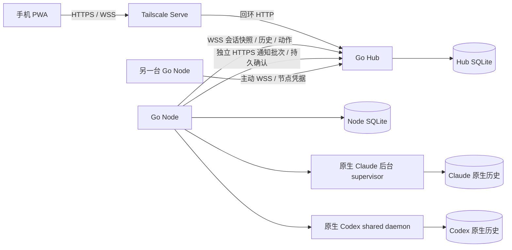

# 架构与运行边界

本文描述当前代码实现。已验证的版本与边界见 [兼容性](COMPATIBILITY.md) 与 [验收说明](ACCEPTANCE.md)。实现一个接口不等于所有平台均已验收。

## 角色与通信

同一个 `pocket` 二进制有三种角色：`hub` 提供 PWA、应用认证、聚合、路由、元数据和推送；`node` 在执行机器上发现与控制原生 agent；`both` 在一台机器运行两者，本机 Node 仍通过经过认证的回环 WebSocket（会话）和独立 HTTP（通知）与 Hub 通信。纯 Hub 不加载 provider，也不需要 Claude/Codex 登录。

Go 1.24 构建后端，SQLite 使用 `modernc.org/sqlite`，无需系统 SQLite 动态库。React/TypeScript/Vite 生成 PWA，生产资源通过 Go embed 放入二进制，运行时无需 Node.js、npm 或外部前端服务。`gorilla/websocket` 承载 Hub/Node、浏览器事件和 Codex 原生协议；Claude 终端入口使用 PTY。两种 agent 的推理、工具、配置和会话保存均由原生软件执行。

Hub 仅允许回环监听，默认 `127.0.0.1:8787`。Tailscale Serve 提供 tailnet 内 HTTPS；远程 Node 的 Hub 地址必须为 HTTPS origin，仅本机回环允许 HTTP。Node 无需额外入站监听。设备候选来自 `tailscale status --json`；候选、Tailscale 在线和已配对应用节点是三个不同概念，候选不会被自动安装或执行命令。

Node 大约每秒发起一次发现扫描，每 500 毫秒检查会话快照变化；通知发送器独立检查持久事件，以最多 32 条的小批次 POST 到 `/api/node/events`，失败按 0.5–15 秒退避。两条连接不共享写锁，历史返回或快照传输卡住不会阻塞通知发送；扫描时长会增加实际延迟，不能把这些间隔当作端到端性能保证。Hub 的 30 秒读期限与设备最后心跳共同识别断线。浏览器订阅带递增游标的事件，并定期读取快照校准。历史按需通过 Node 从原生来源分页读取，HTTP 默认返回最新 50 条，手机首屏请求 20 条，不在启动时汇总全部 transcript。

## 通知持久化与独立投递

Node 将轮次观察点与关注事件写入同一个 SQLite 事务。写失败不前移内存状态；重启时即使 `last-sessions` 尚未保存，也不会重复记录同一转变。该机制覆盖已观察到的原生状态变化；轮询间发生又消失的状态、磁盘不可用期间的中间状态不能宣称全部捕获。

通知专用 HTTP 每次验证节点凭据，事务内复查撤销状态；控制端将事件与 `(nodeId, eventId)` 去重标记同时落盘后才确认。执行设备只保存明确确认的游标，超时、断线、确认丢失和重启会重放未确认事件。通知携带会话身份和目录范围，不携带正文/审批，允许通知先于会话快照到达；独立通道不会把设备伪装成在线或可控制。旧节点的 WebSocket 事件仍兼容；升级时先控制端、后执行设备，新节点连接旧控制端时保留队列等待升级，不回退到共用通道。

控制端使用最多 8 个推送 worker，每个订阅只排队/发送一个批次；每批最多处理 500 个事件，运行期限 30 秒，普通推送每次网络请求期限 5 秒。某个订阅超时不会串行拖住其他订阅；测试通知另有 worker，不占真实事件队列。启动将已有订阅游标移至最新事件，不重放积压；重要事件唤醒，15 秒定时检查新事件。网络等待不持有数据库连接或会话锁。

推送按事件 ID 生成稳定 tag/topic。普通提醒只尝试一分钟内、该会话最新且仍未处理的事件；已读结果、已被新原生状态解决的等待、过期及范围外事件跳过。为允许通知先于会话快照到达，只有比事件更新的原生观察才能用状态差异取消提醒。每次发送前先消费游标，首次发送失败后仅按 1/2/4 秒最多重试三次；每次重试重新检查是否仍需提醒。超预算、进程中断或重启不恢复旧提醒；404/410 移除失效订阅，其他永久 4xx 直接丢弃，网络错误、429 和 5xx 使用上述有限重试。网关响应丢失仍可能造成有限次数重复，不能宣称 exactly-once。

普通 Web Push 的 TTL 为 0，要求推送网关不为离线手机保留消息；用户主动发起的诊断测试单独保留 120 秒 TTL。Node 到控制端的持久补传仅用于事件记录和收件箱，不表示手机离线后一定补推。事件记录不会因推送丢弃而删除。新登记设备也从当前事件开始。推送服务接受不等于 iPhone 显示，系统权限和专注模式仍影响提醒。

保留 HTTPS/WSS：PWA 无法使用原始 UDP socket，系统 Web Push 通过 HTTPS 推送服务投递。实时提醒采用上述有限尝试语义；动作、历史和状态仍需要完整可靠的传输，不能随意丢包。两条应用连接共享实际网络与机器资源，不承诺消除 Tailscale 中继延迟。

新安装不再生成 localhost 的 VAPID 联系地址；空地址或旧默认 `mailto:owner@localhost` 使用控制端配置的 HTTPS public URL，显式联系人继续保留。更新不轮换 VAPID 密钥或重建手机订阅。投递诊断只保存白名单中的 Apple 身份拒绝原因，不保存原始响应正文。

## 按需读取与传输效率

打开 `/session/<id>` 时，PWA先读单条会话及其执行设备，不等待下载完整会话列表；概览的设备、会话与偏好各自返回即可更新页面。当前会话内容由真实变化事件触发读取，只在工作时每5秒、空闲时每30秒兜底；快照事件携带最多100个变化会话ID，其他会话变化不触发当前历史读取。浏览器事件WebSocket连接正常时不再额外轮询事件接口；列表/通知每30秒补偿，通知列表仅在关注事件到达时立即刷新。

同一GET的并发调用合并为一次下载；各调用者独立取消，最后一个离开才中止底层请求。页面隐藏或切换会话停止读取，HTTP取消经控制端传递为Node的 `cancel_read`，只取消历史查询，不取消或重发原生写动作。退出登录清除内存页面和在途GET，晚到响应不能重新填回缓存。

最新历史使用 `history?limit=20&sync=1`：Node保留最多32页、合计16MiB的内存页面。Claude通过原生文件身份、大小、mtime/ctime及手机投递覆盖文件的stat版本判断是否需要重读JSONL；读取期间发生变化则下次重读。Codex没有采用未验证的版本假设，仍从原生接口取页。相同内容只返回版本确认；变更时传完整页内ID顺序及变化消息，删除、重写也能表达；基准不匹配或增量不划算时返回完整页。控制端把未变化转换为304，客户端复用原对象；更早消息仍独立分页。缓存不落磁盘，原生记录仍是权威。旧Node不支持增量RPC时自动回退既有历史读取。

静态HTML/JS/CSS在构建时生成Brotli和gzip旁文件，按Accept-Encoding选择，API保留运行时快速gzip和ETag。SW预缓存原始资源URL，由浏览器解压，不额外下载压缩旁文件。Node与控制端WebSocket协商permessage-deflate，仅压缩至少1KiB的数据，使用快速压缩等级；通知仍走独立连接。历史HTTP提供 `Server-Timing: node;dur=...`，表示控制端到执行设备的查询往返时间，可配合浏览器Resource Timing区分下载与渲染；不记录正文或凭据。

## 身份、状态与原生所有权

应用会话 ID 为 `SHA256(nodeId + NUL + provider + NUL + profile + NUL + nativeId)`。同名目录、不同设备、两个 provider、多 profile 和同目录多个会话均独立。Node 的随机身份保存在本机 `config.json`，重启不会重新生成。工作目录是会话属性，不是身份。

`nativeId` 标识原生持久会话；`executionId` 标识当前原生执行实例。恢复停止的会话可以保留 native ID，同时产生新的 execution ID。Hub 与 Node 对控制动作验证目标、profile、native ID 和执行代次；过期实例和请求不能被静默替换。只读历史与 Codex 原生命令入口不要求一个尚存的执行实例。

执行实例状态与当前轮次状态分开。轮次为 `working`、`waiting_approval`、`waiting_input`、`completed`、`interrupted`、`error` 或 `unknown`。离线是设备连接状态，不能被解释为 agent 已停止。Provider 读取失败时，Node 保留已有会话展示，但将实例及轮次置为 `unknown`、清除待处理请求并禁用控制。不根据“长时间没有输出”猜测完成。

### Claude Code

适配器读取原生项目 JSONL 历史，结合 `claude agents --json --all` 获取活实例；启动使用原生 `--bg`，控制连接使用 `claude attach`。实际 worker 由 Claude 的 supervisor 持有，Pocket 仅持有可断开的终端连接。执行代次由原生 session ID、PID 和进程启动时间组成。

普通聊天通过原生终端输入，只有新写入的、匹配本次文本及时间的原生 user 记录才确认 `accepted`。未得到确认时保留 `submitted` 或 `unknown`。命令不经 shell 拼接，聊天拒绝终端转义、原生 slash/bang 命令。手机与本地 attach 共享原生输入缓冲区，原生终端交互时应避免同时键入。

当前 CLI 不提供可用于本产品的结构化批准请求 ID，审批与提问显示真实原生终端，由用户选择原生选项。终端请求 token 绑定执行代次、等待状态和最近原生工具记录；本地先回答、代次改变或同一等待重复提交时会拒绝旧回答。该 token 不是伪造的原生 approval ID。

交互式 CLI 空闲时通常只报告 idle，没有后台实例的 done 字段。只有最新原生 assistant 明确写入 end_turn、没有后续 user/tool/API 请求，且同一存活实例当前 idle 无等待时，才识别为本轮完成。busy/waiting 和 API 错误优先，无活实例的旧历史不会因此生成完成提醒。该证据复用按文件版本更新的元数据缓存，不增加每秒完整历史扫描。

首次进入不受信任目录时，创建动作可进入“原生启动对话”：Node 在 PTY 内显示 Claude 自己的目录信任界面。此时还没有 native session，不加入会话索引；`startupId` 仅标识临时启动控制器。用户选择后，只有原生返回后台 ID 且与 `agents` 对齐，创建结果才转为 `accepted`。启动对话仅在当前 Node 进程内存在，超时或 Node 重启需要先查原生列表再决定是否重试。后续已通过真实桌面 PWA、远端 Node 与日常 CLI 首次信任闭环，产生原生回复；物理手机操作仍须单独验收。

`interrupt` 向同一原生连接发送 Ctrl+C，只停止当前轮次；`terminate` 调用原生 `claude stop`，停止后台实例但保留历史。Pocket Close 关闭自己的 attach；未完成的临时启动对话会被关闭。对于已有、无该后台控制通道的普通交互 CLI，提供发现与历史，拒绝创建第二个 writer 冒充附着。

### Codex

适配器通过 Unix socket 上的 WebSocket JSON-RPC 连接本机既有 shared app-server daemon。默认 socket 为 `<profile.home>/app-server-control/app-server-control.sock`。不会为已运行 thread 启动另一个 app-server。发现、历史、创建、恢复、发送和中断使用该版本原生 API；历史以 `thread/items/list` 为权威。

执行代次结合 daemon socket 与原生 thread writer lock 的设备号、inode 和时间特征。单纯断开并重新建立 Pocket 连接不会改变实例代次。另有连接 epoch 绑定审批，以防重连后原生 request 编号复用；旧连接的审批不能继续提交。官方原生 writer 锁已被其他实例持有、而 thread 不在当前 shared daemon 中时，只读展示，不尝试竞争恢复。

命令/文件批准和原生 `request_user_input` 使用实际请求与可用选项；成功处理还会观察原生请求已解决事件。本地先处理的请求从待办移除。未覆盖的复杂请求回到原生终端处理。当前 `thread/unsubscribe` 实测不能可靠终止单个原生执行实例，因此不提供 Codex `terminate` 能力；可以中断当前 turn，并返回连接相同 daemon 的官方 TUI 命令。

## 原生配置与凭据

每个 profile 指定 provider、名称、原生 home、绝对 CLI binary，可附本机 env 与 Codex endpoint。原生用户配置、项目指令、MCP/skill、模型及批准策略保持原生来源；不写入默认 bypass。Live attach 继承现有执行实例的启动环境，修改 Pocket 配置不会改变已运行实例。临时 CLI 启动参数无法从历史完整恢复，需在明确的原生启动方式/profile 中提供。

`service install --role node|both` 从安装时终端捕获有限的原生认证/服务地址环境变量到执行机器 `node-env.json`，权限 `0600`，所在应用目录 `0700`。Node 启动时读取它，已有进程环境优先于该文件，profile env 再用于所启动的原生命令。Hub API 不读取或发送此文件，也不发送 profile env；纯 Hub 安装不捕获它。原生凭据仍由原生 home/钥匙串或执行设备环境管理，不要求重新登录到 Hub。

该隔离不是任意内容脱敏：会话文本会按用户请求经 Hub 到手机；动作去重日志保存实际动作文本与结果，可能包含用户输入的敏感内容。不要把会话内容、应用数据目录或原生记录当成可公开日志。应用节点 token、owner token 与浏览器会话凭据也不同于模型 provider 凭据。

## 应用认证、配对与撤销

首次 Hub 启动在本机生成 `owner-token`。推荐在 Hub 运行 `pocket login-qr` 或从已登录设置页生成五分钟、单次消费的二维码，手机通过 HTTPS 兑换浏览器会话；长期 owner token 不进入二维码，短时码经 URL fragment 传入并立即移除。原 `pocket token` 登录表单保留作本机调试/回退。浏览器获得 HttpOnly、SameSite=Strict cookie，HTTPS public URL 下为 Secure，默认 30 天；服务器保存 cookie 散列与到期时间，退出登录删除该会话。Owner token 也可作为 API Bearer 凭据，长期凭据不放 URL。

Owner 在设备页生成 10 分钟有效的一次性配对码；执行设备运行 `pocket pair`，Hub 在事务中登记 Node token 的散列并消费配对码。Node 原始 token 仅留在节点配置。浏览器 Origin 不允许调用 Node 配对/Node WebSocket/Node 通知接口；浏览器 API 与事件 WebSocket 要求应用认证并检查 Origin。设置 `publicUrl` 后严格使用该 origin，不以代理传入的身份头代替应用认证。

撤销节点会删除 Hub 关联和会话索引、关闭现有 Node 连接，原 token 无法重连。它不会停止原生任务，也不会删除节点配置或原生历史。恢复接入需重新配对；Both 的本机节点也不会在撤销后偷偷重新登记。

## 动作交付、恢复与通知

手机为每个动作生成稳定随机 action ID。Hub 与 Node 的 SQLite 均先保存动作摘要，再执行并持久保存结果；同 ID 同内容返回已有结果，同 ID 不同内容拒绝。Provider 内部串行控制避免自身并发写入；原生所有者检查处理外部 writer。

`submitted` 表示已进入动作流程、尚待原生确认；`accepted` 表示适配器获得相应原生证据；`rejected` 表示明确拒绝；`unknown` 表示交付/确认结果无法确定。WebSocket 写入或 HTTP 200 本身不证明原生接受。进程重启时未完成的 `submitted` 转为 `unknown`。浏览器在已登录应用全局跟踪未确认动作，事件/重连唤醒并每 5 秒兜底查询，隐藏时暂停，不依赖某张状态卡仍挂载。Claude 在完整原生 transcript 中核对唯一投递标记或终端文本与时间，未命中按文件版本缓存，避免反复解析未变化历史。仅原生证据可以恢复确认，不会自动重发 prompt；无法校准的结果需用户查看原生历史后明确决定再次发送，不承诺跨任意故障的绝对 exactly-once。

Node 把需关注的真实状态转换写入持久事件表；Hub 按 Node 身份与事件编号事务去重，再给 Node 确认游标。浏览器重连按 Hub 事件游标补发。Web Push 独立读取 Hub 持久事件，使用本机 VAPID 密钥和浏览器订阅，向支持的推送服务发送状态与会话深链接。默认推送不含 prompt 或 transcript；普通提醒按上文规则有限重试后丢弃，失效订阅移除。送达推送服务不等于手机实际展示，锁屏与关闭 PWA 的真实手机验收需单独记录。

Hub 以 endpoint 的 SHA-256 返回有效订阅身份，浏览器校准其本机订阅是否仍存在；已获系统授权时，应用启动/前台恢复/重连会自动修复登记；正常每五分钟检查，失败十五秒后再查。不自动弹授权或发测试通知，明确失效的订阅才重新建立。同 endpoint 刷新 keys 保留已有事件 cursor。Service Worker 仅本地保存最近 20 条 eventId/stage/at，区分收到 push、显示 API resolved/rejected 与点击；这些记录不含正文或凭据，API resolved 不代表实际锁屏展示，点击也仍需核对目标。

Hub 以持久偏好保存 `workspaceScope` 和由 node ID、绝对路径组成的关注项目，手机与电脑共享。路径匹配包含子目录并保持设备和目录边界；这个偏好不扩大节点 roots 授权。概览、设备树、最近会话、收件箱与推送使用相同范围，子 agent 不进入默认主列表。原生索引继续完整发现，历史筛选可复用既有会话，移除关注不删除历史或停止进程；已因范围跳过的通知不会在重新关注后补发。

活跃主会话要求原生 execution 存活；正在工作还需要本轮 working 证据。需要处理要求存活实例上的 pending 或真实等待状态，不按完成未读、历史错误或已退出实例的残留等待计算。execution unknown 单独进入待确认筛选，不归入已退出历史；项目标签筛选同时作用于活跃与历史。Claude 已退出的残留 pending 清空；被外部 writer 持有的 Codex 可以显示 alive/turn unknown，但不会凭空生成 execution ID 或开放控制。

手机关闭、手机断网和 Hub/Node 服务重启不会主动终止已建立的持久原生实例。macOS 用户服务重启后，两种 provider 的相同 native ID/执行代次已真实验证；这不代表操作系统重启、原生 daemon 升级、Linux 服务或所有外部启动路径均已验证。

## 数据归属与备份

| 位置 | 内容 | 恢复性质 |
| --- | --- | --- |
| 各设备原生 Claude/Codex home 与原生相关配置 | 原生历史、原生状态、模型登录与原生设置 | 原生权威，按原生软件规则保留和备份 |
| Node `config.json` | 稳定 node ID、配对 token、profile、目录白名单、PATH | 不可由历史重建；不复制给另一台正在运行的节点 |
| Node `node-env.json` | 本机安装时捕获的原生运行环境 | 敏感本机配置，不同步到纯 Hub |
| Hub `hub.sqlite` | 设备关联、会话索引、动作确认、用户元数据、关注项目偏好、事件、浏览器认证、VAPID、推送订阅 | 仅会话索引部分可重建；其余需备份 |
| Node `node.sqlite` | 动作去重、确认结果、事件和游标、最近状态 | 影响重连及去重语义，不能当作任意可删缓存 |
| `owner-token`、`logs/`、服务配置 | 应用管理凭据、诊断日志、安装入口 | 凭据需保留；日志可能包含路径与原生错误 |
| 手机浏览器 localStorage/Service Worker | 草稿、最近动作摘要、事件游标、PWA 静态资源、最多 20 条通知阶段诊断 | 本机浏览器数据，清理会丢失草稿；不缓存 API 历史响应，诊断不含通知正文或密钥 |

`sessions` 是可重建索引，别名、收藏、隐藏、已读、完成标记在独立 metadata 表，原生历史不会因 UI 隐藏而删除。删除整个 SQLite 数据库会同时失去凭据关联、元数据、去重与通知游标，不能称为单纯重建索引。备份和恢复步骤见 [安装文档](INSTALL.md)。
